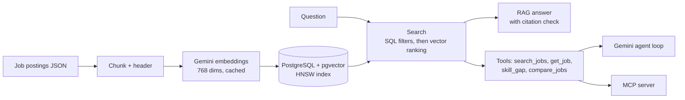

# Job Match Agent

[](https://github.com/abhishekchugh707/job-match-agent/actions/workflows/tests.yml)

Ask questions about job postings in plain language and get answers that point back to the postings they came from.

```
> Which remote jobs involve LLMs or AI agents and don't need German?

Steps:
  1. search_jobs({"query": "LLM AI agents", "remote": true, "max_german": "none"})
  2. get_job({"job_id": "alpenglow-ai"})
  3. get_job({"job_id": "pirol-fullstack-remote"})
  4. search_jobs({"query": "AI agent machine learning prompt engineering", "remote": true, "max_german": "none"})

1. AI Engineer (LLM Applications) at Alpenglow AI [alpenglow-ai]
   Remote (EU), English only. RAG, prompt design and evaluation, Python/FastAPI services.
2. Full Stack Engineer (TypeScript) at Pirol Learning [pirol-fullstack-remote]
   Remote (EU), English only. Next.js and Node.js, including an LLM-based tutor.
```

I built this while looking for a job in Germany. Two questions kept coming up: which postings actually fit me, and which ones quietly need German. Keyword search answers neither well. The repo ships with 25 fictional postings, so everything here runs without real company data.

There are three ways in, all built on the same search and the same four tools:

- `ask`: retrieval-augmented answers (RAG) with citations
- `agent`: a Gemini tool-calling agent that decides for itself what to look up
- an MCP server, so any MCP client (VS Code, Cursor, the MCP Inspector) can use the tools directly

## How it works



### Exact filters before semantic search

My first version returned a job that needs German B2 for the question "jobs that don't need German". To an embedding, "German not required" and "German B2 required" look almost the same. So German level, remote and city are stored as columns and filtered in SQL, and only the remaining chunks get ranked by meaning. The agent picks these filters itself from the wording of the question, as in the example above.

### Chunks carry their context

Each chunk starts with a short header (title, company, location, German level), so a chunk like "3+ years of Python" still says which job it belongs to.

### Citations are checked

The model has to cite job ids like `[alpenglow-ai]`. The code checks every cited id against the postings it was actually given and removes anything invented. If the postings don't contain the answer, the model has to say so.

### The agent has limits

At most 6 tool calls per question. After that the tools are switched off and the model answers with what it has. Every call is recorded, so you can see exactly what it did. Wrong arguments or a failing tool go back to the model as an error message instead of crashing the run.

### The tools exist once

`app/tools.py` holds the four functions and their JSON schemas. The Gemini agent and the MCP server both call exactly that code.

### A busy API doesn't stop it

The free Gemini tier often returns 503 or 504 when a model is overloaded. Requests retry with back-off, and if the main model stays busy the code moves on to fallback models (`gemini-3.6-flash`, then `gemini-3.5-flash-lite`). That happened during the evaluation below.

## Results

`python -m app.evaluate` runs 24 questions from `data/eval_questions.json` against the demo data. 21 have known right answers. The other 3 ask for things the postings don't contain: a company car, a salary and relocation to Japan. Results from 16 Nov 2026:

| Retrieval, top 5 jobs | Hit rate | Recall | MRR |
|---|---|---|---|
| all 21 answerable questions | 100% | 98% | 1.00 |
| the 4 questions with filters | 100% | 100% | 1.00 |
| the same 4 without filters | 100% | 100% | 0.83 |

| Answers (`--answers`) | Result |
|---|---|
| cites a correct job | 21/21 |
| no invented citations | 24/24 |
| says it can't find the answer to unanswerable questions | 3/3 |

All answers in this run came from `gemini-3.5-flash-lite`. The two larger models were overloaded the whole time, so the fallback took over for every question.

Some honesty about these numbers:

- I wrote the questions knowing the data, and most of them contain a clear keyword. Real questions are messier, so treat the scores as optimistic.
- The one miss is real. For "Which jobs use FastAPI?", two postings that mention FastAPI further down (one only as a nice-to-have) didn't make the top 5. Embeddings capture what a text is mostly about, and one keyword deep in a posting gets lost. Combining vector search with Postgres full-text search (hybrid search) would be the next fix.
- The filters do more than the table shows. Without them the right jobs still appear, just lower and mixed with jobs that need German. With them, every result is a job you can actually apply to. The metrics only measure ranking, so they miss that.

The full report is in [eval/results.md](eval/results.md).

## Running it

You need Python 3.12, Docker and a free Gemini API key from [Google AI Studio](https://aistudio.google.com/apikey).

```bash
git clone https://github.com/abhishekchugh707/job-match-agent.git
cd job-match-agent
python -m venv .venv
source .venv/bin/activate          # Windows: .venv\Scripts\activate
pip install -r requirements-dev.txt

cp .env.example .env               # then put your key in GEMINI_API_KEY
docker compose up -d               # PostgreSQL + pgvector on port 5433
python scripts/check_gemini.py     # shows which models your key can call right now
python -m app.ingest               # chunk, embed and store the demo jobs
```

Then try it:

```bash
python -m app.search "backend jobs with FastAPI" --max-german none
python -m app.ask "Which jobs use Kubernetes?"
python -m app.agent "I know Python, FastAPI, Docker and PostgreSQL. Compare the Nordlicht and Kranich jobs and tell me what I'm missing for each."
python -m app.evaluate --answers
```

The same features as an HTTP API, with interactive docs at http://localhost:8000/docs:

```bash
uvicorn app.main:app --reload
```

| Endpoint | What it does |
|---|---|
| `GET /search?q=...` | semantic search with optional filters (`german`, `max_german`, `remote`, `location`) |
| `POST /ask` | RAG answer with citations |
| `POST /agent` | agent answer plus the list of tool calls |
| `GET /health` | health check |

### Using the MCP server

The server talks MCP over stdin and stdout, so the client starts it. To try it by hand in the MCP Inspector:

```bash
npx @modelcontextprotocol/inspector .venv/bin/python -m app.mcp_server
```

To add it to an MCP client, point the client at the venv's Python, with absolute paths:

```json
{
  "mcpServers": {
    "job-match": {
      "command": "/path/to/job-match-agent/.venv/bin/python",
      "args": ["-m", "app.mcp_server"],
      "cwd": "/path/to/job-match-agent"
    }
  }
}
```

Docker has to be running, because the tools read from the database.

### Your own postings

`python -m app.ingest --file my_jobs.json` loads any file in the same format as `data/demo_jobs.json`. Unchanged jobs are skipped on the next run. Keep real postings in `data/private/`, which git ignores.

## Tests

```bash
python -m pytest -q
```

The tests use fake embeddings and scripted fake models, so they never call Gemini. The database tests need `TEST_DATABASE_URL` and are skipped without it. GitHub Actions runs all of them against a real pgvector container on every push.

## Project layout

```
app/
  chunking.py     split postings into header-prefixed chunks
  embeddings.py   Gemini embeddings with a SQLite cache
  db.py           schema and pgvector helpers
  ingest.py       load postings into the database
  search.py       SQL filters + vector search
  rag.py, ask.py  answers with checked citations
  llm.py          Gemini calls, retries, model fallback
  tools.py        the four tools and their schemas
  agent.py        the tool-calling loop
  mcp_server.py   the same tools over MCP
  evaluate.py     retrieval metrics and answer checks
  main.py         FastAPI app
data/             demo postings and evaluation questions
eval/results.md   latest evaluation report
```

## Stack

Python 3.12, FastAPI, PostgreSQL with pgvector, psycopg 3, Google Gemini (google-genai SDK), the MCP Python SDK, pytest and GitHub Actions.

## License

MIT, see [LICENSE](LICENSE).
